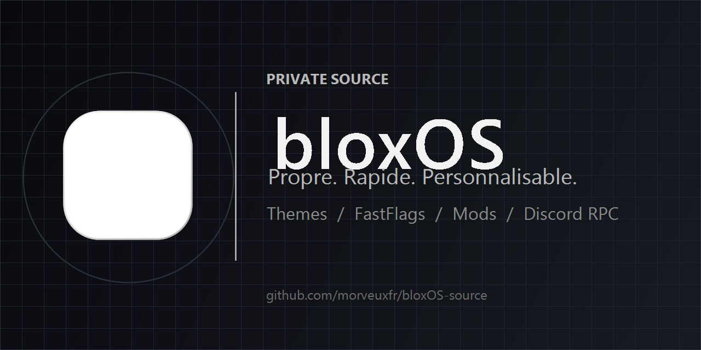
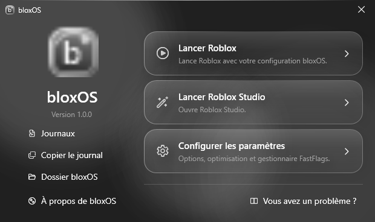
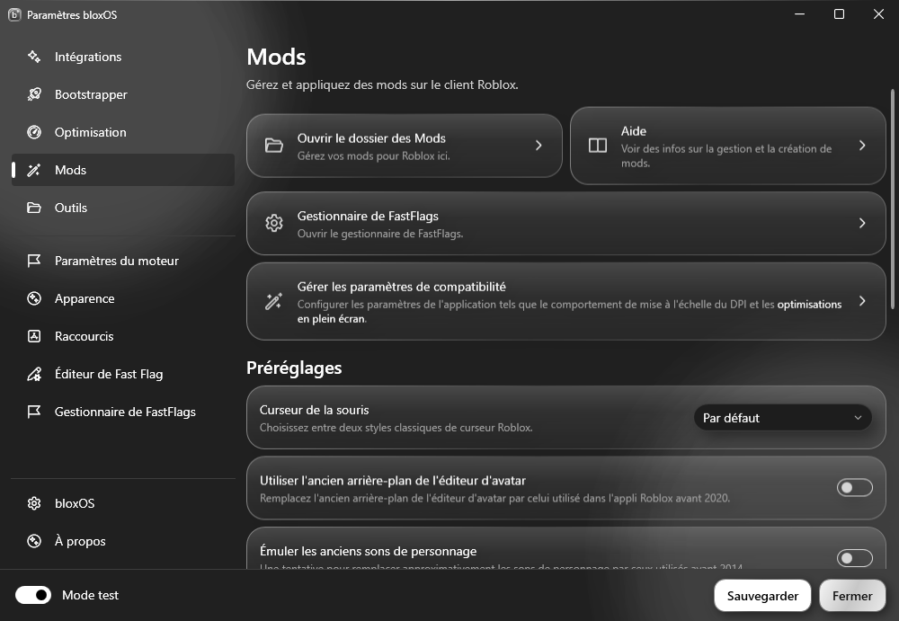

# bloxOS

**Un lanceur propre, rapide et entièrement personnalisable pour Windows.**

[`Télécharger l'EXE`](https://github.com/morveuxfr/bloxOS/releases/download/v1.0.0/bloxOS-setup.exe) · [Dernière version](https://github.com/morveuxfr/bloxOS/releases/latest) · [Discord](https://discord.gg/zS7VTNGVS)

---

## Pourquoi bloxOS

bloxOS prend le meilleur d'un bootstrapper moderne et le rend réellement agréable à utiliser : interface nette, démarrage rapide, thèmes sobres, FastFlags maîtrisés et présence Discord qui ressemble enfin au projet.

  

<table>
  <tr>
    <td width="50%" align="center"><b>Paramètres</b> </td>
    <td width="50%" align="center"><b>Mods</b> </td>
  </tr>
</table>

---

## Fonctionnalités

| | |
| --- | --- |
| Interface premium | Design sombre et clair, panneaux compacts, navigation sans chevauchement |
| Thèmes | Light, Dark, Graphite, Ocean, Emerald, Violet et Ember |
| FastFlags | Preset complet, éditeur, gestionnaire et liste autorisée stricte |
| Performance | Priorité élevée, mode faible configuration, optimisations globales |
| Mods locaux | Curseurs, police, badge cosmétique, sons d'impact, musique, impacts silencieux |
| Discord RPC | État lanceur, paramètres, outils, À propos, FastFlags, jeu et invitation |
| Outils | Journaux, dossier d'installation, actions rapides et diagnostics |
| Installation | Setup autonome, aucun .NET à installer |

---

## Téléchargement

Télécharge directement [`bloxOS-setup.exe`](https://github.com/morveuxfr/bloxOS/releases/download/v1.0.0/bloxOS-setup.exe) puis lance-le.

Le setup :

1. installe bloxOS dans `%LOCALAPPDATA%\bloxOS` ;
2. crée les raccourcis nécessaires ;
3. lance automatiquement l'application.

Le fichier [`SHA256SUMS.txt`](SHA256SUMS.txt) permet de vérifier l'intégrité du setup.

---

## Discord

Rejoins le serveur pour les mises à jour, l'aide et les annonces : [discord.gg/zS7VTNGVS](https://discord.gg/zS7VTNGVS)

> Le code source est privé. Ce dépôt contient uniquement l'application compilée, le setup et sa présentation.
