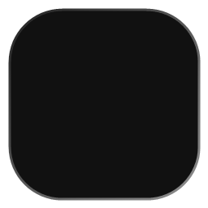
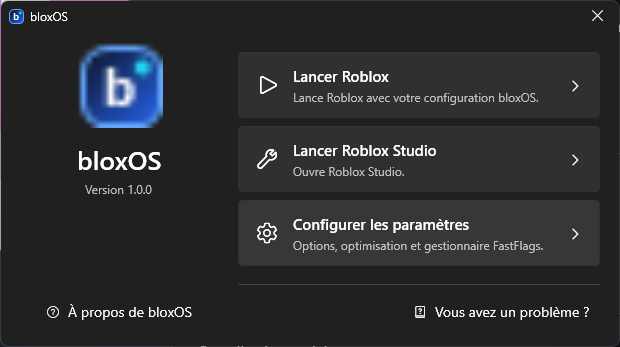
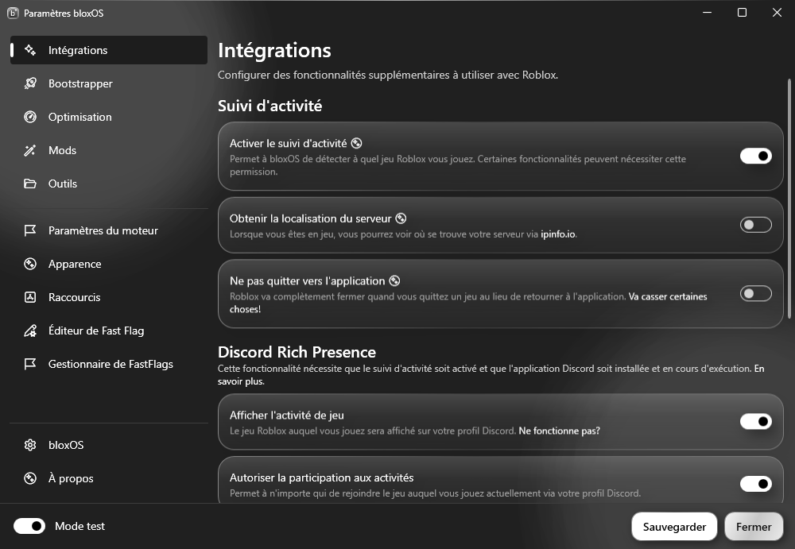

  

<h1 align="center">bloxOS</h1>

  Un bootstrapper Roblox propre, rapide et personnalisable pour Windows.

  

  
  
  

---

## Téléchargement

Clique sur le bouton **Télécharger bloxOS** ou va sur [la page Releases](https://github.com/morveuxfr/bloxOS/releases/latest), puis télécharge `bloxOS-v1.0.0-win-x64.zip`.

Extrais l'archive puis lance `bloxOS.exe`. Aucune installation de .NET n'est nécessaire.

Le fichier [`SHA256SUMS.txt`](SHA256SUMS.txt) permet de vérifier l'archive.

## Aperçu

  

  

## Ce que contient bloxOS

- Lancement direct de Roblox ou Roblox Studio
- Paramètres avec thème gris graphite
- Gestionnaire FastFlags dédié
- Discord Rich Presence avec logo bloxOS
- Mode faible configuration et priorité Roblox élevée

## Discord

Rejoins le Discord pour les mises à jour et l'aide : [discord.gg/zS7VTNGVS](https://discord.gg/zS7VTNGVS)

> Le code source est privé. Ce dépôt contient uniquement l'application compilée et sa présentation.
